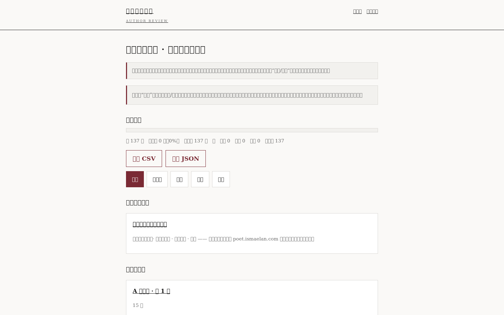
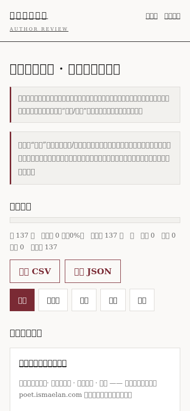
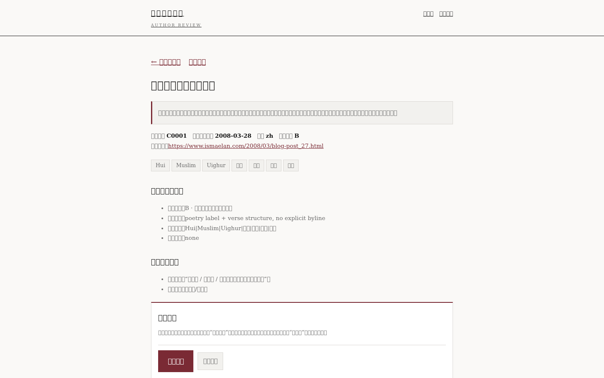
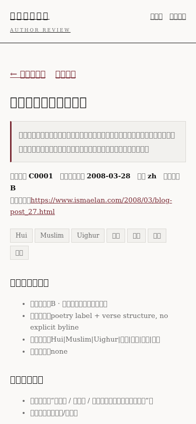

# 作者审阅系统 · 使用教程

> 面向作者本人（普通用户）的说明，不需要任何编程知识。
> 本教程依据仓库中的**实际代码与实测结果**编写；文中“截图”来自真实构建的本地页面。
>
> 教程中的“审阅令牌”是一串只有你（和你的助手）知道的密码。**本文件不包含任何真实令牌**。

---

## 0. 先看最重要的一件事（务必先读）

**审阅记录保存在“运行审阅服务的那台机器”上，而不是保存在你的浏览器里。**

这意味着：

- 只要你**点了“保存审阅”并看到“保存成功”**，这条决定就已经写进服务器文件，关闭浏览器、换设备后仍在。
- 但如果**服务器（预览机器）被关闭或回收**，页面上能“读”到的历史记录可能读不出来。
- 因此：**每审完一批，请务必让助手做一次“导出 + 备份”**（见第 8 节）。

> **【事实】** 当前这套审阅系统运行在“临时预览机”上。预览机不是永久服务器。

---

## 1. 如何进入审阅系统

### 1.1 你需要一个网址

审阅入口不在公开诗歌站（`poet.ismaelan.com`）上，也不在 Vercel 预览站上。
它由一台**单独启动的审阅预览机**提供，形如：

```
https://<预览主机>/review/
```

`<预览主机>` 由启动审阅服务的助手告诉你（例如某个 `…prod-runtime.all-hands.dev` 主机）。

### 1.2 打开的正确顺序

1. 让助手先启动审阅服务，并把**主机地址**和**令牌**给你。
2. 在浏览器打开：`https://<预览主机>/review/?token=<令牌>`（令牌第一次用，之后浏览器会记住）。
3. 打开后你会看到“**作者审阅总目录**”。

### 1.3 需要登录吗？需要令牌吗？

- **不需要用户名密码登录。**
- **需要“审阅令牌”**（一串密码）。带令牌打开一次后，浏览器会记住，后续页面不再需要反复输入。
- 令牌由**启动审阅服务的助手**设置和管理，**不在网页上、不在仓库里**。

> **【事实】** 若服务未设置令牌，则任何拿到网址的人都能读写；因此面向作者使用时**必须设置令牌**。
> 设置了令牌后：不带令牌访问 `/review/` 或接口，一律返回 **401（拒绝）**——这是正常的保护，不是故障。

### 1.4 真实截图

| 桌面 · 总目录 | 手机 · 总目录 |
| --- | --- |
|  |  |

> 截图目录：`screenshots/author-review-entry/`。截图用**合成（空）数据**抓取，
> 所以所有条目都显示“待审阅”——**截图里不含任何真实审阅决定**。

---

## 2. 如何查看候选记录

打开总目录后，页面上有这些部分：

1. **页眉**：`安然诗歌档案 · Author Review`，右上角可回“总目录 / 批次索引”。
2. **说明横幅**：提醒“候选 = 脚本筛出的**文章**，不等于已确认的诗歌”。
3. **审阅进度**：一条进度条 + 一行文字，例如
   `共 137 篇　已审阅 0 篇（0%）　未审阅 137 篇 ｜ 保留 0　暂缓 0　排除 0　待审阅 137`。
4. **导出按钮**：`导出 CSV` / `导出 JSON`（下载全部记录）。
5. **筛选按钮**：`全部 / 待审阅 / 保留 / 暂缓 / 排除`，点一下只看对应的记录。
6. **旧站现有页面（审阅）**：单独一页，列出旧站已有页面（那拉提、青春的物语、诗人小传、题记）供你确认。
7. **按批次阅读**：A 类第 1–7 批、B 类第 1–3 批、C/D 类第 1 批。
8. **完整清单（表格）**：137 行，每行有
   `# / 编号(如 C0001) / 标题 / 日期 / 分类 / 语言 / 审阅状态 / 阅读·审阅 / 原始来源`。

### 2.1 如何进入某一条的阅读与审阅页

- 在**完整清单**里，点该行的 **“阅读/审阅”**；或
- 在**按批次**页面里，点 **“阅读全文 →”**。

### 2.2 单条审阅页里能看到什么

进入某一条（例如 C0001）后，从上到下是：

1. 顶部返回链接：`← 审阅总目录`、`本批目录`。
2. **标题**与**审阅副本提示**（“这是审阅副本，不是正式发表版本”）。
3. **元信息**：候选编号、原始发表日期、语言、脚本分类，以及**原始来源链接**。
4. **为什么列出这篇**：脚本的分类与线索（供你参考，不是结论）。
5. **需要作者确认**：这篇是“一首/多首/非诗”，署名归属等。
6. **作者审阅表单**（见第 3 节）。
7. **原文（逐字保留）**：这首诗/这篇文章的完整正文。
8. 底部：如有差异请对照“原始来源”。

| 桌面 · 单条审阅页 | 手机 · 单条审阅页 |
| --- | --- |
|  |  |

---

## 3. 如何逐条审阅（每个选项的含义）

审阅表单有三个部分，**可以只填你确定的部分**：

### ① 审阅结论（下拉框）

| 选项 | 含义 |
| --- | --- |
| 待审阅 | 还没决定（默认）。 |
| **保留** | 确认收入诗歌站。 |
| **暂缓** | 现在不定，以后再说。 |
| **排除** | 不收入诗歌站。 |

### ② 作品性质（下拉框）

| 选项 | 含义 |
| --- | --- |
| （未填写） | 默认，不填。 |
| 一首诗 | 这一篇是**一首**诗。 |
| 多首诗 | 这一篇含**多首**（组诗/外一首等）。 |
| 非诗（评论/消息/摄影等） | 其实不是诗。 |
| 尚不确定 | 暂时分不清。 |

### ③ 作者意见（大文本框）

你可以写任何备注，例如“与旧站版本不同，以本版为准”“第二段需要再核对换行”。
最多 20000 字。可留空。

> **【事实】** 系统**只有**以上这些选项，没有别的隐藏按钮。请不要去找教程里没有的东西。

---

## 4. 如何保存

1. 填好表单后，点页面底部的 **“保存审阅”** 按钮（按钮会一直固定在页面底部，手机上也能看到）。
2. 保存时按钮变灰，状态显示 **“正在保存…”**。
3. 成功时状态显示 **“保存成功”**，并在下面显示 **“上次保存：YYYY-MM-DD HH:MM（第 N 版）”**。

**如何确认真的保存成功：**

- 必须看到 **“保存成功”** 字样（绿色底），并且出现 **“上次保存时间（第 N 版）”**。
- **只看到“有未保存的修改 / 有未保存的草稿”不算保存成功**——那只是浏览器的临时草稿。
- 如果看到 **“保存失败：…”**（红底），说明**没有**写入，请重试或联系助手。

> **【事实】** 只有服务器返回成功，界面才会显示“保存成功”；写入 localStorage 一律**不算**成功。

---

## 5. 如何继续审阅

- **进入下一条**：点页面顶部 **“← 审阅总目录”** 回到清单，再点下一条的“阅读/审阅”。
  （批次页里按顺序点“阅读全文 →”也可以。）
- **返回上一条**：用浏览器的**后退**按钮，或回到总目录重新点。
- **查看还有多少待审**：总目录顶部的进度行会显示 `未审阅 N 篇`；点筛选按钮 **“待审阅”** 只看还没处理的。
- **查看已处理的**：点筛选 **“保留 / 暂缓 / 排除”**，只看对应状态的记录。
  （当前版本**没有**单独的“上一条 / 下一条”按钮——见第 9 节“尚未提供”。）

> **【事实】** 单条审阅页**没有**“上一条/下一条”按钮。目前请通过“总目录 / 批次页”切换。

---

## 6. 中途退出怎么办

- **只要看到过“保存成功”**：这条决定**已经保存在服务器**，关闭浏览器、重启电脑后仍在。
- **如果只是填了、没点保存**：浏览器会在**本机**临时留一份草稿；下次在**同一台设备、同一个浏览器**打开这一条，草稿会自动填回。换设备则**看不到**这份草稿。
- 所以：**每审完一条就点一次“保存审阅”**，是最稳妥的习惯。

---

## 7. 遇到问题怎么办

| 现象 | 可能原因 | 怎么办 |
| --- | --- | --- |
| 打开 `/review/` 显示 401 或“需要访问令牌” | 没有带令牌，或令牌不对 | 用带 `?token=…` 的网址打开；或向助手索取新令牌。 |
| 提示“审阅令牌无效” | 令牌被改过或过期 | 联系助手重新设置并给你新令牌。 |
| 页面打不开 / 一直转圈 | 审阅预览机没在运行，或被回收 | 让助手**重新启动**审阅服务并给你新网址。 |
| 点保存后显示“保存失败：网络错误（未保存）” | 预览机离线或网络中断 | 先别关页面；让助手确认服务在线，再点一次“保存审阅”。 |
| 已保存的记录没有显示 | 服务重启后读不到历史记录 | **不要**在页面上继续覆盖式保存；立刻联系助手（见第 8、9 节，这属于数据风险）。 |
| 不确定某条怎么分类 | 拿不准“一首/多首/非诗” | 选 **“暂缓”** 或 **“尚不确定”**，并在意见里写下你的疑问；**不要**勉强下结论。 |

---

## 8. 让助手做的三件“保命”事（建议每批一次）

1. **导出**：总目录点 `导出 CSV` / `导出 JSON`，另存到电脑。
2. **备份**：请助手运行备份命令，把记录复制到**这台机器之外**（真正的异地/私有远端）。
3. **确认**：请助手运行校验命令，确认备份完好。

> **【事实】** 备份/校验/恢复命令见 `tools/review/README.md`；
> 本沙盒内的“另一个目录”**不算**异地备份，整台机器被回收时会一起丢失。

---

## 9. 当前版本的已知限制（请知悉）

1. **没有“上一条 / 下一条”按钮**：只能在总目录或批次页之间切换。
2. **记录保存在预览机上**，不是永久服务器；预览机被回收后，**若未备份则可能读不到历史记录**。
3. **Vercel 预览站上目前没有审阅入口**（它只发布正式诗歌页，不含 `/review/`）。
4. **必须由助手启动审阅服务并设置令牌**，作者本人无需（也无法）自行部署。

---

## 10. 一页速查（打印版）

1. 打开 `https://<预览主机>/review/?token=<令牌>`。
2. 看到“作者审阅总目录”。
3. 点某行“阅读/审阅” → 读原文 → 选 ①审阅结论 ②作品性质 → 写 ③意见。
4. 点底部 **“保存审阅”** → 看到 **“保存成功（第 N 版）”** 才算成功。
5. 回总目录 → 点下一条，继续。
6. 每批结束：导出 + 让助手备份。
